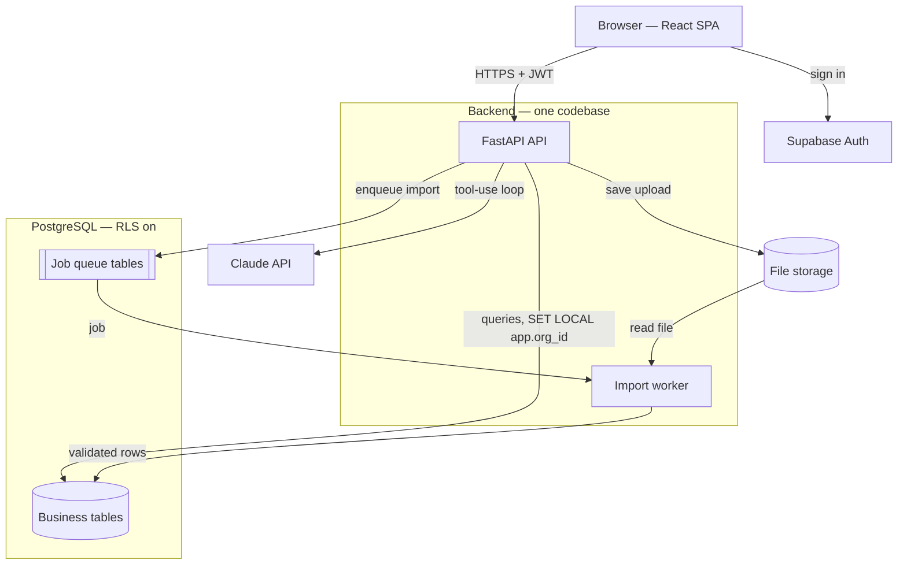
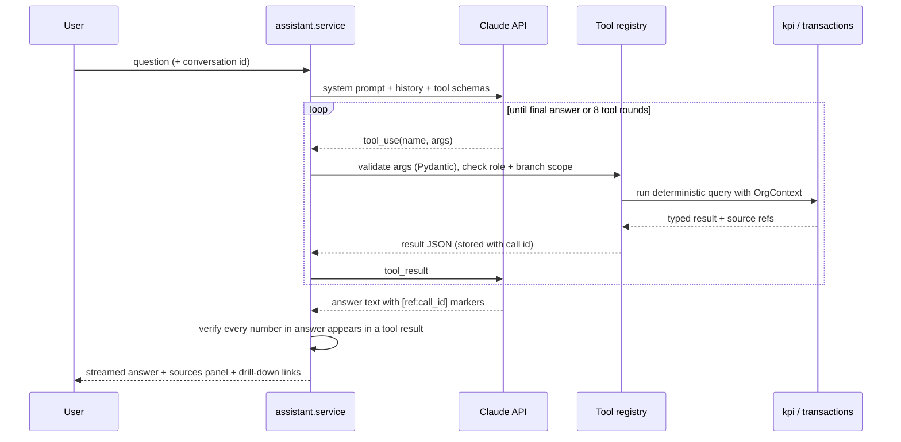
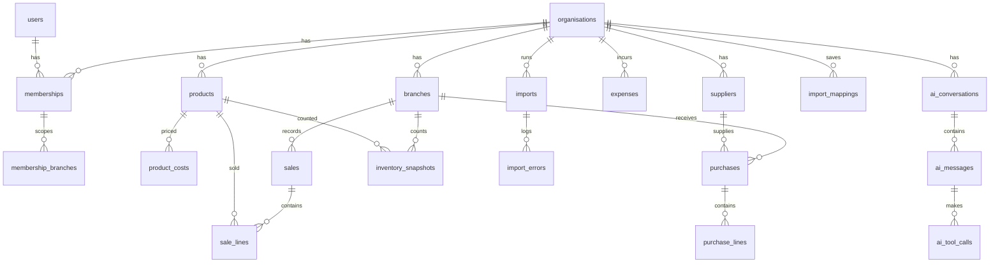

# EOS AI — Phase 0 Plan

Status: approved with changes · 2026-10-30

## Decisions from owner review (2026-10-30)

| Question | Answer | Effect on the plan |
| --- | --- | --- |
| Code location | Private GitHub repo `eos-ai` | Pushed at each phase end |
| Target customers | All businesses, not POS-specific | Data model and importer stay industry-agnostic; demo company is a general multi-branch trading business; header synonyms cover POS, ERP and accounting exports |
| Arabic | Later | English UI now; all text goes through one strings module so RTL/Arabic can be added without rewrites |
| Database | Supabase, inside the existing mdf-hrms project | All tables live in a dedicated `eos` schema with their own `eos_app` role; nothing in `public` is touched; the schema is not exposed through the Supabase Data API |
| Defaults | Multicurrency | Base currency chosen per organisation at sign-up (any ISO 4217 code, decimals from the currency); transactions keep their own currency; FX rates per org; KPIs in base currency with FX coverage shown |

Shared-project caveat: Supabase Auth users are shared with the other apps in mdf-hrms. EOS AI only trusts users who hold an EOS membership, so sharing auth does not grant access, but moving to a dedicated project before real customers is recommended.

EOS AI is built as one FastAPI modular monolith on PostgreSQL, with a React SPA, a Postgres-backed job queue for imports, and a Claude tool-use loop that can only reach data through typed, tenant-scoped tools. Nothing in this plan adds infrastructure beyond what the MVP needs.

---

## 1. Architecture



### Modules inside the monolith

| Module | Owns | Talks to |
| --- | --- | --- |
| `core` | config, DB session, tenancy context, auth dependency, errors, logging | everything |
| `orgs` | organisations, settings, memberships, roles, branch access | core |
| `catalog` | branches, products, product costs, suppliers | core |
| `ingest` | uploads, mapping, validation, import jobs, import errors, dedupe | catalog, transactions |
| `transactions` | sales, sale lines, purchases, purchase lines, inventory snapshots, expenses, FX rates | catalog |
| `kpi` | KPI functions (pure, tested), period logic, coverage | transactions |
| `assistant` | Claude provider, tool registry, chat loop, conversation store, usage log | kpi, transactions |
| `reports` | daily sales report, PDF/XLSX export (Phase 5) | kpi |
| `audit` | audit log writes | core |

Rule: modules call each other through their `service.py`, never by importing another module's models directly. That keeps later extraction possible without doing it now.

### Request lifecycle (tenancy)

1. Frontend sends `Authorization: Bearer <Supabase JWT>` and `X-Org-Id`.
2. `get_current_user` verifies the JWT signature against Supabase JWKS; no network call per request after keys are cached.
3. `get_org_context` loads the membership for (user, org). No membership → 404 (not 403, so org existence isn't leaked).
4. The DB session runs `SET LOCAL app.org_id = '<uuid>'` and `SET LOCAL app.user_id` inside the request transaction.
5. Repositories require an `OrgContext` argument and always filter by `org_id`. RLS policies (`org_id = current_setting('app.org_id')::uuid`) catch anything a repository misses.
6. Branch scope: Managers and Viewers with `all_branches = false` get a `branch_ids` filter applied in repositories and KPI functions.

The app connects as a dedicated `eos_app` role that is **not** the table owner and has no `BYPASSRLS`, so RLS actually applies. Migrations run as the owner role.

### AI assistant loop



Number verification: after the model answers, a checker extracts numeric tokens from the text and confirms each matches (after rounding) a value present in that turn's tool results or a simple derived value the tool returned. Unmatched numbers are flagged in the UI and logged as eval failures. This is the guardrail behind "the model never invents figures".

Imported strings reach the model only inside tool results, wrapped as JSON values. The system prompt states that tool results are data. Injection rows in the demo data test this.

---

## 2. Database schema

Conventions for every business table: `id uuid pk default gen_random_uuid()`, `org_id uuid not null fk`, `created_at`, `updated_at timestamptz`, and where rows come from files: `source_import_id uuid fk imports`, `source_row_number int`. Money is `numeric(18,4)` (covers 0–3 decimal currencies; display rounding uses each currency's minor units), unit costs and FX rates `numeric(18,6)`, quantities `numeric(14,3)`. No floats.



### Tables

All tables below live in the `eos` schema.

**Identity and access**

| Table | Key columns | Notes |
| --- | --- | --- |
| `organisations` | name, base_currency (char 3, chosen at sign-up), timezone, fiscal_year_start_month (1–12), tax_rate numeric(5,4), prices_include_tax bool, date_format, is_demo bool, deleted_at | No `org_id`; RLS by membership |
| `users` | id = Supabase auth uid, email, full_name | Mirror of auth user, created on first login |
| `memberships` | org_id, user_id, role enum(owner, manager, viewer), all_branches bool | unique(org_id, user_id) |
| `membership_branches` | membership_id, branch_id | Only when all_branches = false |
| `invitations` | org_id, email, role, token_hash, expires_at, accepted_at | Owner invites users |

**Catalog**

| Table | Key columns | Notes |
| --- | --- | --- |
| `branches` | code, name, city, is_active | unique(org_id, code) |
| `products` | sku, name, category, unit, is_active | unique(org_id, sku) |
| `product_costs` | product_id, effective_from date, unit_cost, currency | Cost at time of sale = latest row with effective_from ≤ sale date |
| `suppliers` | code, name | unique(org_id, code) |

**Transactions**

| Table | Key columns | Notes |
| --- | --- | --- |
| `sales` | branch_id, receipt_no, sold_at timestamptz, business_date date, status enum(completed, voided, refund), currency, gross_amount, discount_amount, vat_amount, net_amount, customer_ref | unique(org_id, branch_id, receipt_no); `business_date` computed in org timezone at import |
| `sale_lines` | sale_id, product_id null, raw_product_ref, qty, unit_price, gross, discount, vat, net, unit_cost_snapshot null, is_return, original_sale_line_id null | Returns are negative qty/amount lines |
| `purchases` | branch_id, supplier_id, doc_no, purchased_on, currency, total_ex_vat, vat_amount | unique(org_id, supplier_id, doc_no) |
| `purchase_lines` | purchase_id, product_id, qty, unit_cost, line_total | |
| `inventory_snapshots` | branch_id, product_id, snapshot_date, qty, unit_cost | unique(org_id, branch_id, product_id, snapshot_date) |
| `expenses` | branch_id null, category, description, incurred_on, currency, amount_ex_vat, vat_amount, supplier_id null | `branch_id` null = head office |
| `fx_rates` | currency, rate_date, rate_to_base | unique(org_id, currency, rate_date) |

**Ingest**

| Table | Key columns | Notes |
| --- | --- | --- |
| `imports` | entity_type, file_name, file_hash sha256, storage_path, status enum(uploaded, mapping, validating, ready, importing, done, failed), conflict_mode enum(skip, replace, append), rows_total, rows_imported, rows_rejected, rows_duplicate, mapping_id, quality_report jsonb, created_by, started_at, finished_at | Every row accounted: total = imported + rejected + duplicate |
| `import_errors` | import_id, row_number, column_name, error_code, message, raw_row jsonb | Downloadable as CSV |
| `import_mappings` | entity_type, name, column_map jsonb, transforms jsonb | Saved and re-suggested by header signature |

**Assistant, audit**

| Table | Key columns | Notes |
| --- | --- | --- |
| `ai_conversations` | user_id, title | |
| `ai_messages` | conversation_id, role, content, verified bool, unverified_numbers jsonb | |
| `ai_tool_calls` | message_id, tool_name, args jsonb, result jsonb, duration_ms, error | Source panel reads from here |
| `ai_usage` | user_id, model, input_tokens, output_tokens, cost_usd numeric(12,6), latency_ms | Cost estimate per request |
| `audit_logs` | user_id, action, entity, entity_id, metadata jsonb | Append-only |

### Indexes that matter for KPIs

- `sales (org_id, business_date, branch_id)` and partial index `where status <> 'voided'`.
- `sale_lines (org_id, sale_id)`, `(org_id, product_id)`.
- `inventory_snapshots (org_id, branch_id, product_id, snapshot_date desc)`.
- `expenses (org_id, incurred_on, category)`.
- `product_costs (org_id, product_id, effective_from desc)`.

Materialised daily rollups (`daily_branch_sales`, `daily_product_sales`) are deferred until a query is measured as slow; the brief says simplest first.

---

## 3. API outline

All routes under `/api/v1`, JSON, org-scoped routes require `X-Org-Id`. Errors use one shape: `{"error": {"code", "message", "details"}}`. Lists paginate with `limit` + cursor.

| Area | Endpoints |
| --- | --- |
| Health | `GET /health`, `GET /health/db` |
| Me | `GET /me` (user + memberships) |
| Orgs | `POST /orgs`, `GET /orgs/{id}`, `PATCH /orgs/{id}/settings` (owner) |
| Members | `GET /members`, `POST /invitations`, `POST /invitations/{token}/accept`, `PATCH /members/{id}` (role, branches), `DELETE /members/{id}` |
| Catalog | `GET/POST/PATCH /branches`, `GET /products`, `GET /suppliers` |
| Imports | `POST /imports` (multipart upload → preview), `GET /imports/{id}`, `GET /imports/{id}/preview`, `PUT /imports/{id}/mapping`, `POST /imports/{id}/validate`, `POST /imports/{id}/commit` (conflict_mode), `GET /imports/{id}/errors.csv`, `GET /imports` (history), `GET /mappings` |
| KPIs | `GET /kpis?from&to&branch_ids&compare=previous_period` → list of KPI objects |
| Breakdowns | `GET /analytics/sales?dimension=branch|product|category|day|hour&from&to`, `GET /analytics/top-items?metric&limit` |
| Drill-down | `GET /records/sales?filters`, `GET /records/sales/{id}`, `GET /records/expenses?filters` |
| Assistant | `POST /assistant/conversations`, `POST /assistant/conversations/{id}/messages` (SSE stream), `GET /assistant/conversations`, `GET /assistant/messages/{id}/sources` |
| Reports | `GET /reports/daily-sales?date&branch_ids`, `…/export?format=pdf|xlsx` (Phase 5) |
| Demo | `POST /demo/seed` (owner, creates labelled demo org; disabled in prod unless flag) |

KPI object shape (every KPI endpoint and tool returns this):

```json
{
  "key": "net_sales",
  "label": "Net sales",
  "value": "12450.250",
  "previous_value": "13020.000",
  "change_pct": "-0.0438",
  "currency": "OMR",
  "coverage_pct": "1.0000",
  "row_count": 8421,
  "period": {"from": "2026-09-01", "to": "2026-09-30"},
  "previous_period": {"from": "2026-08-01", "to": "2026-08-31"},
  "last_import_at": "2026-10-01T06:12:00Z",
  "status": "complete",
  "notes": []
}
```

Decimals travel as strings to avoid float rounding in JSON.

### Assistant tools (Phase 4)

| Tool | Args | Returns |
| --- | --- | --- |
| `get_kpis` | from, to, branch_codes?, kpi_keys? | KPI objects |
| `compare_periods` | kpi_key, period_a, period_b, branch_codes? | values, delta, delta_pct |
| `get_sales_breakdown` | dimension, from, to, branch_codes?, limit | rows + share of total |
| `get_top_items` | metric (net_sales, gross_profit, qty), direction, from, to, limit | ranked rows |
| `get_expense_breakdown` | from, to, category?, branch_codes? | rows |
| `get_inventory_status` | branch_codes?, as_of | value, qty, oldest snapshot date |
| `get_import_status` | — | data coverage per entity and last import times |

---

## 4. Folder structure

```
eos-ai/
├── CLAUDE.md                     # how to run, test, seed; key decisions
├── DEVELOPMENT_STATUS.md
├── README.md
├── docker-compose.yml            # postgres 16, (later) worker
├── .env.example
├── .github/workflows/ci.yml      # lint + typecheck + tests, both apps
├── docs/
│   ├── PHASE_0_PLAN.md
│   └── adr/
├── backend/
│   ├── pyproject.toml            # uv-managed
│   ├── alembic.ini
│   ├── migrations/
│   ├── app/
│   │   ├── main.py
│   │   ├── core/                 # config, db, tenancy, auth, errors, logging
│   │   ├── orgs/                 # models, schemas, repository, service, router
│   │   ├── catalog/
│   │   ├── transactions/
│   │   ├── ingest/               # parsers, mapper, validators, jobs
│   │   ├── kpi/                  # definitions.py (pure), periods.py, service.py
│   │   ├── assistant/            # provider/, tools/, loop.py, verify.py
│   │   ├── reports/
│   │   └── audit/
│   ├── worker.py                 # procrastinate worker entrypoint
│   ├── scripts/
│   │   └── generate_demo_data.py
│   └── tests/
│       ├── unit/                 # KPI maths, parsers, verifier
│       ├── integration/          # API + DB, tenancy isolation
│       └── fixtures/
├── frontend/
│   ├── package.json
│   ├── src/
│   │   ├── app/                  # router, providers, layout
│   │   ├── lib/                  # api client, auth, formatters (money, dates)
│   │   ├── components/ui/        # shadcn
│   │   ├── components/           # KpiCard, DataTable, DateRangePicker, BranchFilter
│   │   └── features/
│   │       ├── auth/  orgs/  imports/  dashboard/  records/  assistant/  reports/
│   └── tests/ e2e/
└── eval/
    ├── questions.yaml
    └── run_eval.py
```

---

## 5. Data ingestion strategy (Phase 2 detail)

1. **Upload**: store file, compute SHA-256. Same hash already imported → warn before going further.
2. **Sniff**: CSV dialect and encoding (UTF-8, UTF-8-BOM, Windows-1256 for Arabic exports), Excel sheet picker, header row detection (first row with ≥60% non-empty string cells).
3. **Profile each column**: inferred type (date, datetime, number, money, text), null %, distinct count, sample values, date format candidates (DD/MM/YYYY is the default for GCC; ambiguous dates flagged, never guessed silently).
4. **Suggest mapping**: saved mapping with same header signature → reuse; else synonym dictionary (English + common Arabic headers, e.g. "Receipt No", "Bill No", "رقم الفاتورة") plus type fit. No LLM in the mapper for the MVP; it can be added later as a suggestion source.
5. **Validate** with the canonical Pydantic row model per entity: required fields, numeric parse, date parse, branch/product resolution (unknown branch → error; unknown product → create or error, user's choice), VAT consistency check against org setting.
6. **Quality report**: counts of valid, invalid by error code, duplicates within file, duplicates vs existing data, date range covered, totals per branch for a sanity check against the user's own system.
7. **Commit** in a background job, chunked 5,000 rows per transaction, with `conflict_mode` deciding what happens to natural-key duplicates. Invariant asserted at the end: `rows_total = imported + rejected + duplicate`.

---

## 6. Technical risks

| Risk | Likelihood | Impact | Mitigation |
| --- | --- | --- | --- |
| Tenant data leak | Low | Severe | Repository filter + RLS with non-owner app role; isolation tests across API, tools and repositories in CI |
| POS exports vary wildly (layouts, Arabic headers, encodings, merged cells) | High | High | Saved mappings, encoding detection, test with real exports early (needs samples from you) |
| Missing unit costs make gross profit unreliable | High | Medium | `product_costs` table, coverage % on COGS/GP, "partial" status shown on cards |
| Model states a number not in the data | Medium | High | Tools-only data access, post-answer number verifier, eval set in CI |
| Prompt injection through product names or notes | Medium | Medium | Data only inside tool results, no write tools in MVP, injection rows in eval |
| Ambiguous dates (03/04/2026) | High | High | Org-level date format, per-import confirmation, ambiguity flagged |
| Large files (500k+ rows) slow or time out | Medium | Medium | Background job, chunked commits, progress polling; benchmark in Phase 2 |
| Claude API cost per question | Medium | Medium | Usage table, per-org monthly cap setting, compact tool results |
| Payment provider unavailable for an Oman entity | High | Low now | Billing out of MVP scope; decide entity country before Phase 6 |
| Scope creep back to the 12-module vision | High | High | Phase gates; anything new goes to a backlog list in DEVELOPMENT_STATUS.md |

---

## 7. Questions before Phase 1

1. **Where should the code live?** Give me a GitHub repo (owner/name) and I'll push there; otherwise I'll keep building here and send you a zip at each phase end.
2. **Real sample data:** can you share one real export each for sales, purchases or stock from a POS used by your target customers (names can be scrambled)? Which POS systems are common among them?
3. **Arabic:** does the MVP UI need Arabic and right-to-left layout, or English UI with Arabic data only?
4. **Hosting for the pilot:** use your Supabase account (via the connected Supabase tool) for Postgres + Auth, or local Docker only until Phase 3?
5. **Defaults:** OK with OMR, Asia/Muscat, 5% VAT, DD/MM/YYYY and fiscal year starting January as defaults for new organisations?
